<div align="center">

# Rollcall

### Stop calling names. Start the class.

Face-recognition attendance: students enrol once on their own phone, a teacher points a camera, and the register fills itself. No photos are kept.

**[Live site](https://rollcall-classroom.vercel.app)** · **[Project report (PDF)](docs/Rollcall-Project-Report.pdf)**

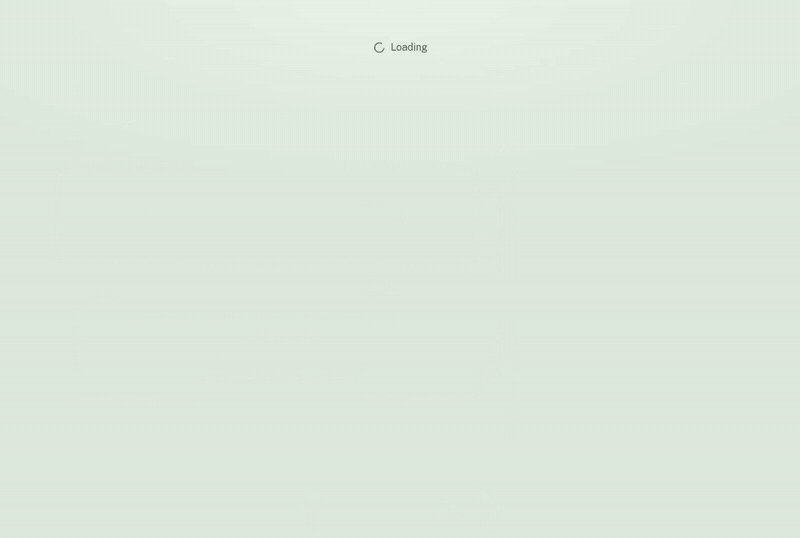

</div>

All faces in these images and recordings are AI-generated synthetic images, not real people. The names are invented test data.

The API sleeps when idle on its free tier, so the first request afterwards can take about a minute. The site shows a "waking the server" banner while it waits.

## How it works

**1. A teacher creates a class** and gets a six-character code to share, or an invite link.

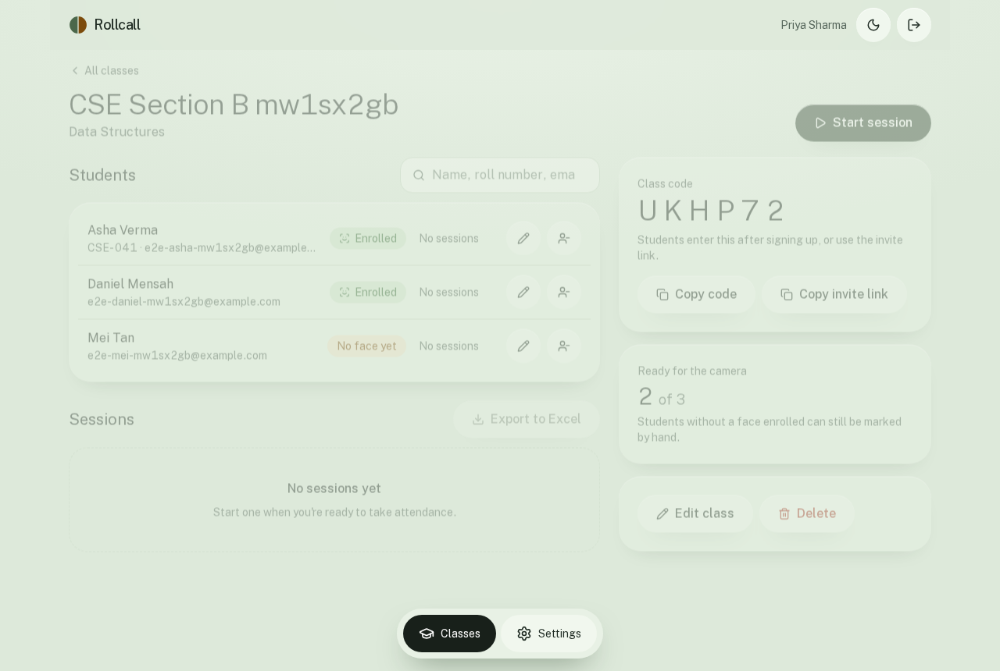

**2. Students join and enrol once.** They tick a consent box, then take five photos on their own phone. The photos become a face template of 128 numbers and are discarded. A student can test recognition before class.

| Enrolling | Student home | Recognition test |
|---|---|---|
| 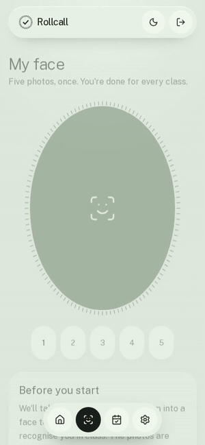 | 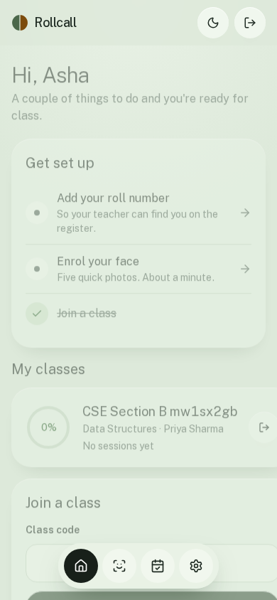 | 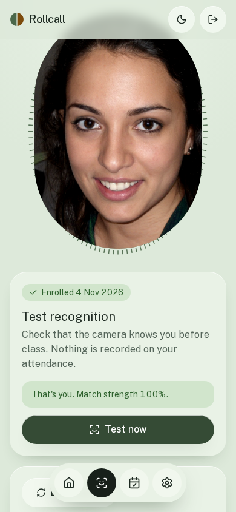 |

**3. The teacher opens a session and points a camera.** Faces are matched against that class only. A green box marks a student, and an amber box means not recognised.

| Live | A stranger stays unrecognised |
|---|---|
| 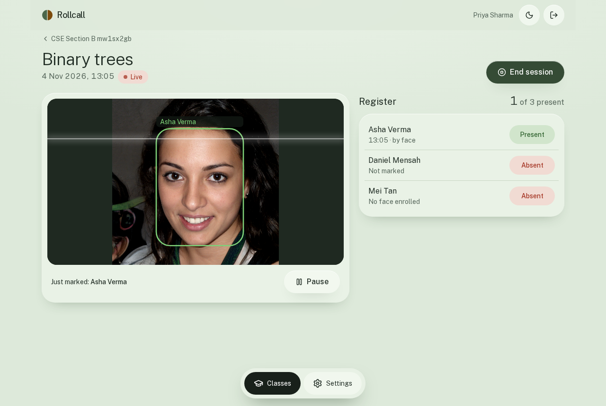 | 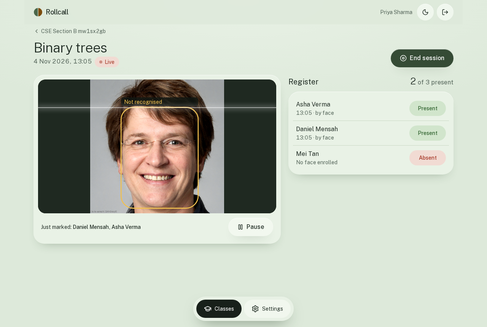 |

**4. The teacher has the last word.** Any entry can be corrected by hand, even after the session ends. Registers export as a CSV that opens in Excel.

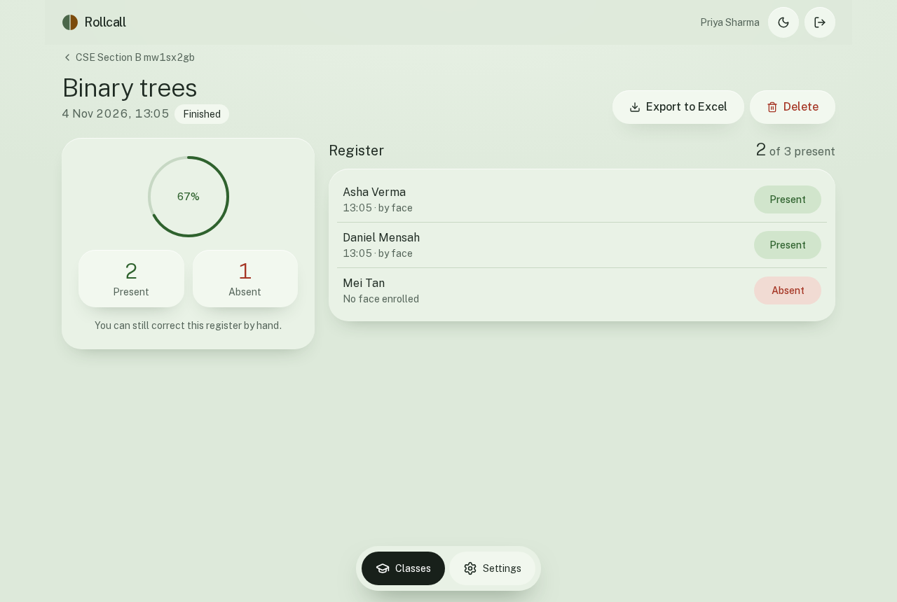

**5. Students see only their own record**, and can delete their template or account at any time.

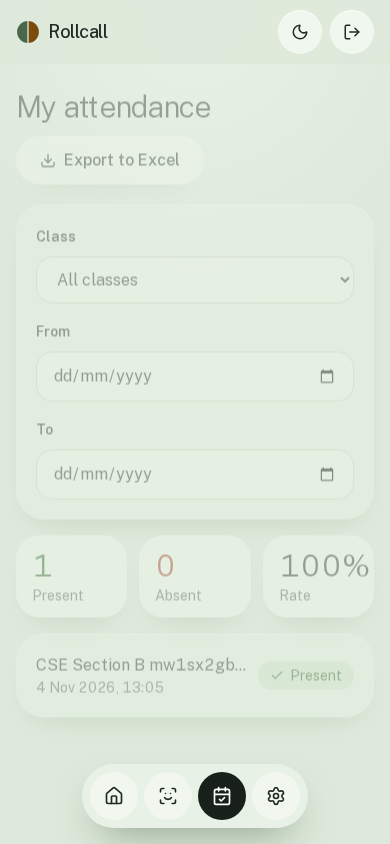

| Landing page | Dark theme |
|---|---|
| 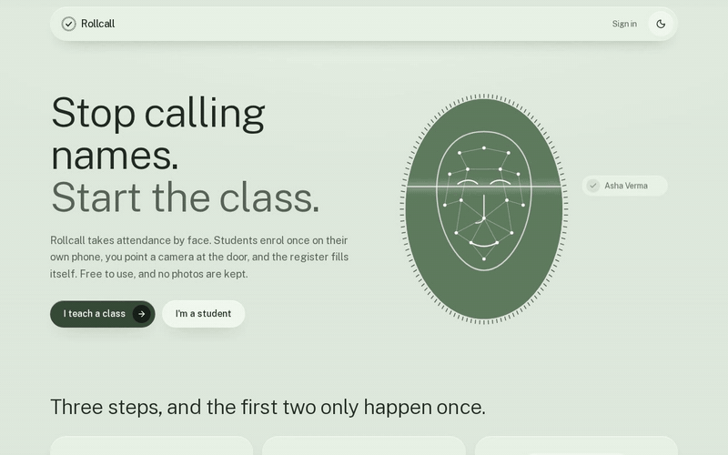 | 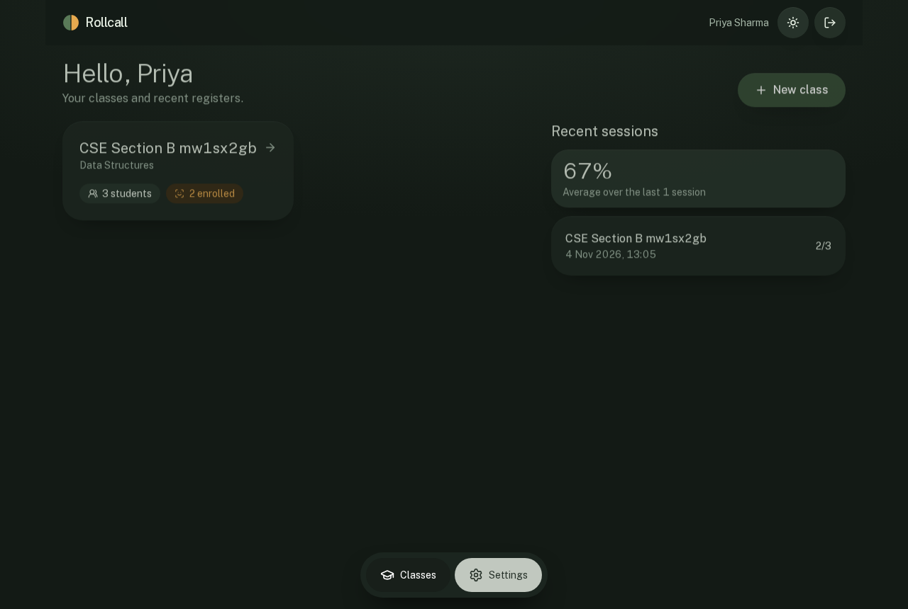 |

## Features

**Teachers**
- Classes with a six-character code and invite link
- Live scanning on a laptop or phone, with boxes and names over the video
- A register that shows the time and whether each mark came from the camera or by hand
- Manual correction during and after a session
- CSV exports per session and per class, plus a roster with enrolment status and editable student details

**Students**
- Guided five-photo enrolment, with each photo checked as it is taken
- A recognition test that does not touch attendance
- Own attendance history, with class and date filters, and an export
- Enrolment is optional: a teacher can always mark a student by hand
- Delete the face template or the whole account at any time

**Safeguards**
- Only students in the class can match, so a visitor stays unknown
- A weak match, or one too close to two students, marks nobody
- Mixed photos are refused at enrolment, using a leave-one-out check
- A face already enrolled on another account is refused
- Light and dark themes, and a banner that explains cold starts

## Architecture

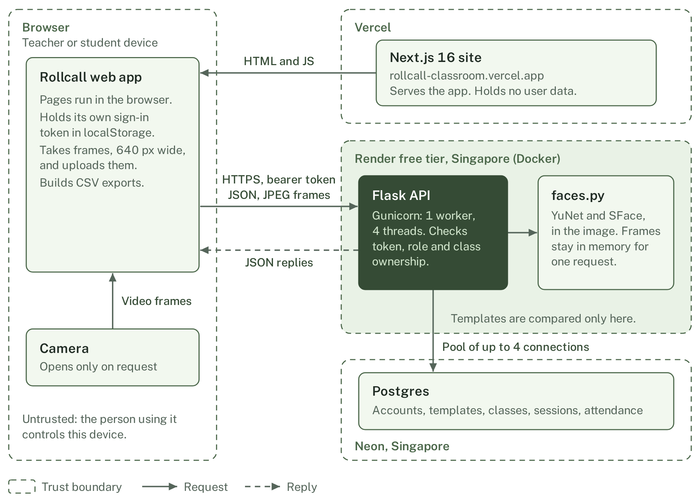

The browser calls the API directly, so no attendance data or camera frame passes through Vercel. More diagrams are in [`docs/diagrams`](docs/diagrams): [enrolment](docs/diagrams/enrolment.png), [recognition](docs/diagrams/recognition.png), [live session](docs/diagrams/live-session.png) and [data model](docs/diagrams/data-model.png). The [report](docs/Rollcall-Project-Report.pdf) explains each one.

## Accuracy

Measured with [`backend/tests/evaluate_threshold.py`](backend/tests/evaluate_threshold.py) on the LFW standard 6,000 pairs. 2,999 same-person and 3,000 different-person pairs were evaluated, and 1 was skipped.

| At threshold 0.42 | Result |
|---|---|
| False accept | 0.0% (0 of 3,000) |
| False reject | 3.4% |
| Highest different-person score | 0.412 |

These are single-photo pair results on a public benchmark, not a classroom study. The app enrols five photos, and accuracy in a real room has not been measured.

## Performance

Measured in the Docker image limited to Render's free-tier size (512 MB, 0.1 CPU) with local Postgres, so database latency to Neon isn't included. Waking from sleep on Render takes longer.

| Measure | Result |
|---|---|
| Memory at idle | about 102 MB |
| Peak memory, 30 face checks plus 16 signups at once | 195 MB |
| Recognition, one face, median / worst | 0.7 s / 0.8 s |
| Recognition, six faces, median | 2.0 s |
| Enrolment, five photos, median | 3.4 s |
| Sign-in, median | 1.1 s |
| Container start to first healthy response | about 10 s |

## Tech stack

| Part | Technology |
|---|---|
| Frontend | Next.js 16, React 19, Tailwind CSS 4, on Vercel |
| API | Flask and Gunicorn in Docker, Python 3.11, on Render's free tier (Singapore) |
| Database | Postgres on Neon (Singapore) |
| Face models | OpenCV YuNet detector and SFace recogniser: 128-number embeddings, cosine similarity |
| Testing | pytest, Playwright |

YuNet and SFace replaced DeepFace and TensorFlow so that the API fits a 512 MB instance.

## Security and privacy

- **Photos are never stored.** Frames are decoded in memory for one request. Only a numeric template is kept, and only after consent.
- **Templates are never returned by the API.** They are read only inside the server to compare faces. They are stored as plain numbers in Postgres.
- **Signed tokens** last 14 days, and a password change signs out other devices. Passwords are hashed with salted scrypt.
- **Role and class checks** on each request: a wrong role gets 403, and another teacher's class or session gets 404.
- **CORS** allows only the production site and configured origins.
- **Rate limits** on sign-up, sign-in, password changes and joining a class. They are basic, in memory, and per process.
- **CSV exports** neutralise cells that Excel would run as formulas.
- **Deletion** of a template or account takes effect at once, and account deletion cascades to attendance.

See the [privacy notice](https://rollcall-classroom.vercel.app/privacy) and section 8 of the report.

## Known limits

- **No liveness detection.** A good photo may fool it, so teachers should watch the camera.
- **No forgot-password email.** There is no email service yet.
- **Free-tier cold start.** The first request after idle can take about a minute.
- **In-memory rate limiting and one process.** Counters reset on restart, and recognition runs one call at a time.
- **Lighting and angle matter.** Small faces are ignored, and poor light lowers scores.
- **Only synthetic faces were used in product testing.** The LFW benchmark is the only measurement on real photographs, and no classroom study has been done.

## Local setup

You need Docker, Python 3.11 and Node 22 or later.

```bash
git clone https://github.com/LSUDOKO/ai_project.git
cd ai_project

# Database
docker run -d --name rollcall-pg -e POSTGRES_PASSWORD=postgres -e POSTGRES_DB=rollcall -p 5433:5432 postgres:17-alpine

# Backend
cd backend
python3.11 -m venv .venv && source .venv/bin/activate
pip install -r requirements.txt
mkdir -p models
curl -fL -o models/face_detection_yunet_2023mar.onnx https://github.com/opencv/opencv_zoo/raw/main/models/face_detection_yunet/face_detection_yunet_2023mar.onnx
curl -fL -o models/face_recognition_sface_2021dec.onnx https://github.com/opencv/opencv_zoo/raw/main/models/face_recognition_sface/face_recognition_sface_2021dec.onnx
sha256sum -c <<'SUMS'
8f2383e4dd3cfbb4553ea8718107fc0423210dc964f9f4280604804ed2552fa4  models/face_detection_yunet_2023mar.onnx
0ba9fbfa01b5270c96627c4ef784da859931e02f04419c829e83484087c34e79  models/face_recognition_sface_2021dec.onnx
SUMS
cp .env.example .env          # then set SECRET_KEY
python app.py                 # http://localhost:5000

# Frontend, in a second terminal
cd frontend
npm install
cp .env.example .env.local
npm run dev                   # http://localhost:3000
```

| Variable | Where | Purpose |
|---|---|---|
| `DATABASE_URL` | API | Postgres connection string. Required |
| `SECRET_KEY` | API | Signs tokens. Required |
| `FRONTEND_ORIGIN` | API | Extra allowed sites, comma-separated |
| `FACE_MATCH_THRESHOLD` | API | Optional, defaults to 0.42 |
| `MODEL_DIR` | API | Optional, defaults to `backend/models` |
| `PORT` | API | Optional, defaults to 5000 when running `app.py` |
| `NEXT_PUBLIC_API_URL` | Frontend | API base URL, fixed at build time |

### Tests

**API tests.** There are 9, and they need a folder with at least 6 JPEGs, one distinct face each.

> **Warning:** these tests drop and recreate the `public` schema of their database. By default that is the local database above. Never point `TEST_DATABASE_URL` at data you want to keep.

```bash
cd backend
pip install pytest
FACE_DIR=<face folder> pytest tests/test_api.py
```

**Browser flow.** It has 24 checkpoints and needs the site and API running, plus Y4M fake camera feeds named `p1`, `p2`, `p3` and `room`: Asha, Daniel and Mei, then a room feed that shows Asha, Daniel and a stranger in turn. The faces must not already be enrolled, because the duplicate check would refuse them, so run it after clearing the local database and not straight after the API tests. A directory passed as `SHOTS` must already exist.

```bash
cd frontend
npx playwright install chromium
FACE_DIR=<feed folder> BASE_URL=http://localhost:3000 API_URL=http://localhost:5000 node e2e/flow.mjs
```

### Rebuilding the docs

Both need `frontend/node_modules`. Retake screenshots with `SHOTS=<dir>` on the flow and copy them to `docs/screenshots`.

```bash
node docs/report/build.mjs       # PDF and docs/diagrams, needs pdftotext and network access for fonts

cd frontend                      # GIFs, needs ffmpeg and the running site
FACE_DIR=<feed folder> BASE_URL=http://localhost:3000 node e2e/record-gifs.mjs
```

## Deployment notes

- **Frontend:** Vercel, with `NEXT_PUBLIC_API_URL` set to `https://rollcall-api-w318.onrender.com`.
- **API:** Render, from [`render.yaml`](render.yaml), using `backend/Dockerfile`. The models are baked into the image and pinned by checksum, so a cold start downloads nothing. Set `DATABASE_URL` and `FRONTEND_ORIGIN` in the dashboard. The blueprint generates `SECRET_KEY`.
- **Database:** Neon. The API applies `schema.sql` on every boot, and each statement is idempotent. The connection pool revalidates connections because Neon closes them when it scales to zero.

## Project layout

```
backend/
  app.py                  API routes, auth, rate limits
  faces.py                detection, embedding, matching
  schema.sql              tables and indexes
  Dockerfile
  tests/                  API tests and threshold evaluation
frontend/
  app/                    pages: landing, sign-in, student, teacher, settings, privacy
  components/             camera, app shell, UI parts, wake banner
  lib/api.ts              API client, CSV export
  e2e/                    browser flow and GIF recorder
docs/
  Rollcall-Project-Report.pdf
  report/                 report source and build script
  screenshots/  gifs/  diagrams/
legacy/                   the original desktop app
render.yaml               Render blueprint
```

## About `legacy/`

Rollcall evolved from a desktop attendance app built with Tkinter and OpenCV, using a Haar cascade and an LBPH model. The code in `legacy/` is kept for reference only. Rollcall doesn't use it, and it has its own requirements files.
